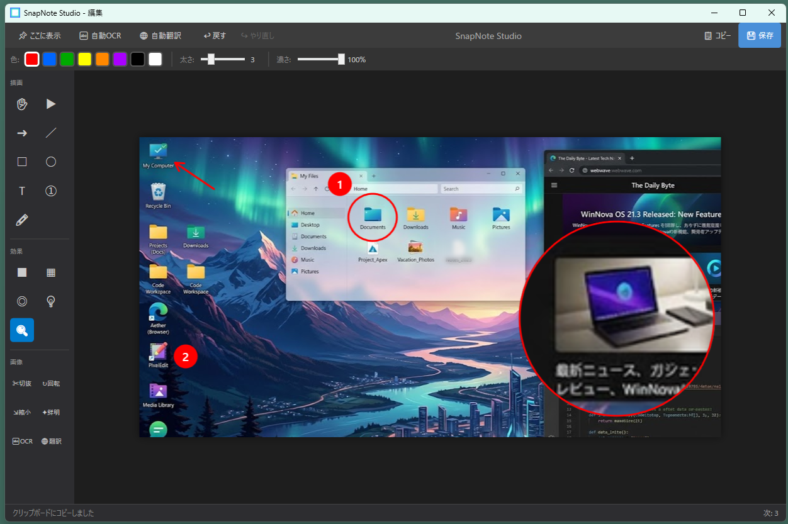
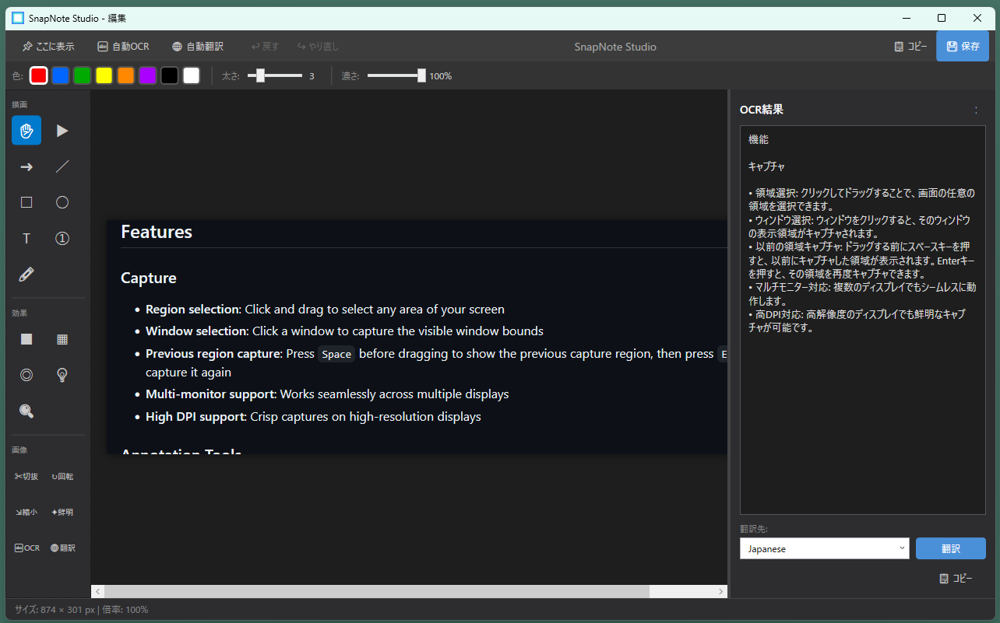

# SnapNote Studio

<p align="center">
  
</p>

**SnapNote Studio** is a screen capture and annotation tool for Windows. Capture any area of your screen, annotate it with arrows, shapes, text, and visual effects, extract text with Windows OCR, and translate OCR results with Ollama.

[日本語版 README](README.ja.md)

<p align="center">
  
</p>

<p align="center">
  
</p>

## Features

### Capture
- **Region selection**: Click and drag to select any area of your screen
- **Window selection**: Click a window to capture the visible window bounds
- **Previous region capture**: Press `Space` before dragging to show the previous capture region, then press `Enter` to capture it again
- **Capture timer**: Press `1`–`9` before selecting an area or window to capture it after a visible 1–9 second countdown
- **Multi-monitor support**: Works seamlessly across multiple displays
- **High DPI support**: Crisp captures on high-resolution displays

### Annotation Tools
| Tool | Shortcut | Description |
|------|----------|-------------|
| Move | Space | Move the image viewport by dragging |
| Select | V | Select and move annotations |
| Arrow | A | Draw arrows to point at things |
| Line | L | Draw straight lines |
| Rectangle | R | Draw rectangles |
| Ellipse | E | Draw ellipses/circles |
| Text | T | Add text with customizable font size |
| Number | N | Add numbered steps (①②③...) |
| Highlighter | H | Semi-transparent highlight pen |

### Effect Tools
| Tool | Shortcut | Description |
|------|----------|-------------|
| Fill | F | Draw filled rectangles |
| Mosaic | M | Pixelate sensitive information |
| Blur | B | Blur sensitive areas |
| Spotlight | S | Darken everything except selected area |
| Magnifier | G | Zoom in on a specific area |

### Image Operations
- **Crop**: Trim the image to a selected area
- **Rotate**: Rotate the image 90° clockwise
- **Resize**: Scale the image with aspect ratio preservation
- **Sharpen**: Apply a gentle sharpen filter to the image

### OCR and Translation
- **Windows OCR**: Extract text from the current image with the Windows OCR engine
- **Multiple OCR languages**: Select one or more installed Windows OCR languages; the best recognition result is used automatically
- **Structured text**: Preserve paragraphs and consecutive bullet or numbered list items in OCR output
- **Integrated result pane**: Review, edit, copy, and resize the OCR result pane without leaving the editor; use `Ctrl` + mouse wheel to change its text size
- **Ollama translation**: Translate OCR results through a configured Ollama endpoint and model, with a selectable or custom target language
- **Quick and automatic processing**: Run OCR, OCR plus translation, Auto OCR, or Auto Translate directly from the editor

### Additional Features
- **Editor zoom and pan**: Use the mouse wheel to zoom up to 1200%, then drag in Move mode or use the middle/right mouse button to pan
- **Undo/Redo**: Full history support (Ctrl+Z / Ctrl+Y)
- **Copy to clipboard**: Quick sharing (Ctrl+C)
- **Save to file**: Automatically saves PNG files with timestamp-based names (Ctrl+S)
- **Save location setting**: Choose the folder used for automatic saves
- **Customizable hotkey**: Choose your preferred capture shortcut
- **Customizable editor shortcuts**: Configure Copy, Save, OCR, Translate, and Close key combinations
- **Reuse editor window**: Use "New Here" to load the next capture into the current editor instead of opening another window
- **Remembered workspace**: Editor size, position, maximized state, automatic OCR/translation toggles, and the reuse-window toggle are retained
- **System tray**: Runs quietly in the background
- **Multi-language**: English, Japanese, Simplified Chinese, Spanish, and Korean support

## System Requirements

- Windows 10/11 (64-bit)
- An installed Windows OCR language pack for each language you want to recognize
- Ollama and an installed model are required only for translation

Release builds are self-contained; the .NET runtime does not need to be installed separately.

## Installation

### Option 1: Download Installer
1. Download the installer (`SnapNoteStudio_Setup_x.x.x.exe`) from the [Latest Release](https://github.com/fukuyori/snapnote/releases/latest) page
2. Run the installer and follow the on-screen instructions

### Option 2: Build from Source

#### Prerequisites
- [.NET 8.0 SDK](https://dotnet.microsoft.com/download/dotnet/8.0)
- [Inno Setup](https://jrsoftware.org/isdownload.php) (only required for creating the installer)
- Visual Studio 2022 or VS Code (optional)

#### Build Steps

```bash
# Clone the repository
git clone https://github.com/fukuyori/snapnote.git
cd snapnote

# Restore dependencies
dotnet restore

# Build
dotnet build -c Release

# Run
dotnet run -c Release
```

#### Publish as Single Executable

```powershell
.\scripts\build-release.ps1

# Output: bin/Release/net8.0-windows10.0.19041.0/win-x64/publish/SnapNoteStudio.exe
```

#### Creating the Installer

With Inno Setup installed, run the following:

```powershell
.\scripts\build-installer.ps1

# Output: installer_output/SnapNoteStudio_Setup_3.2.0.exe
```

## Usage

### Starting a Capture

1. **Hotkey**: Press `Ctrl+Shift+S` (default) to start capture mode
2. **System Tray**: Double-click the tray icon, or right-click and select "Capture"

### Capture Mode

1. Optionally press `1`–`9` to set a capture delay of 1–9 seconds
2. Click and drag to select the area you want to capture
3. Click a window without dragging to capture that window
4. With a timer set, the countdown starts after selection and a fresh screenshot is taken when it reaches zero
5. Press `Space` before dragging to show the previous capture region, then press `Enter` to capture it
6. Press `Escape` to cancel

If no number key is pressed, capture remains immediate.

### Editor

1. Use the left sidebar to select Move mode or annotation tools
2. Adjust color, thickness, and opacity in the top toolbar
3. Draw annotations on the image
4. Use the mouse wheel to zoom, then drag in Move mode or drag with the middle/right mouse button to pan
5. Use `Ctrl+Z` to undo, `Ctrl+Y` to redo
6. Click "Copy" or press `Ctrl+C` to copy to clipboard
7. Click "Save" or press `Ctrl+S` to save to the configured folder
8. Use `Ctrl+X`, `Ctrl+W`, or `Ctrl+Q` for quick close workflows

### OCR and Translation

1. In Settings, select the installed Windows languages that OCR should try. If none are selected, the Windows profile languages are used
2. Click "OCR" or press `Ctrl+Shift+O` to extract text into the resizable result pane
3. Edit the recognized text if needed, then copy it with the pane's "Copy" button
4. For translation, start Ollama and configure its endpoint and model in Settings. The default endpoint is `http://localhost:11434`
5. Choose a target language and click "Translate", or use "Trans" / `Ctrl+Shift+T` to run OCR and translation together
6. Enable "Auto OCR" or "Auto Trans" to process every newly loaded capture automatically

### Settings

Right-click the system tray icon and select "Settings" to open the settings dialog.

| Setting | Description | Default |
|---------|-------------|---------|
| Language | Switch the display language. Supports English / 日本語 / 简体中文 / Español / 한국어 | English |
| Capture hotkey | Select the shortcut key to start screen capture. Available options: PrintScreen / Ctrl+PrintScreen / Alt+PrintScreen / Ctrl+Shift+S / Ctrl+Shift+C / Ctrl+Alt+S / F12 / Ctrl+F12 | Ctrl+Shift+S |
| Start with Windows | When checked, SnapNote Studio will automatically start when Windows starts. Registered via registry (HKCU) | OFF |
| Save location | Folder used by automatic PNG saves. The folder is created when needed | Pictures\SnapNote Studio |
| Thickness | Set the default stroke thickness for drawing tools (1–10) | 3 |
| Opacity | Set the default opacity for drawing tools (10%–100%) | 100% |
| OCR languages | Select one or more installed Windows OCR languages. With no selection, Windows profile languages are used | None selected |
| Ollama endpoint | Ollama server used to translate OCR results | http://localhost:11434 |
| Ollama model | Model used for translation; "Refresh" lists models available from the configured endpoint | Not set |
| Editor shortcuts | Configure Copy, Save, OCR, Translate, and Close shortcuts; each must include Ctrl, Alt, or Win | See defaults below |

## Keyboard Shortcuts

### Global
| Shortcut | Action |
|----------|--------|
| Ctrl+Shift+S | Start capture (default, configurable) |

### Editor (defaults)
| Shortcut | Action |
|----------|--------|
| Ctrl+Z | Undo |
| Ctrl+Y | Redo |
| Ctrl+C | Copy to clipboard (configurable) |
| Ctrl+X | Copy to clipboard and close |
| Ctrl+S | Save to file (configurable) |
| Ctrl+W | Save to file and close |
| Ctrl+Shift+O | Run OCR (configurable) |
| Ctrl+Shift+T | Run OCR and translate (configurable) |
| Ctrl+Q | Close without saving (configurable) |
| Delete | Delete selected annotation |
| Escape | Deselect / Cancel crop mode |
| Space | Switch to Move mode |
| Mouse wheel | Zoom in/out |
| Middle/right button drag | Move the image viewport |
| V, A, L, R, E, T, N, H, F, M, B, S, G | Tool shortcuts |

### Capture Overlay
| Shortcut | Action |
|----------|--------|
| 1–9 | Set a 1–9 second delay that starts after selecting an area or window |
| Space | Show the previous capture region before dragging |
| Enter | Capture the displayed previous region |
| Escape | Cancel capture |

## Configuration

Settings are stored in:
```
%APPDATA%\SnapNoteStudio\settings.json
```

## License

MIT License - see [LICENSE](LICENSE) file for details.

## Contributing

Contributions are welcome! Please feel free to submit a Pull Request.

## Acknowledgments

- [Hardcodet.NotifyIcon.Wpf](https://github.com/hardcodet/wpf-notifyicon) for system tray functionality
- Built with .NET 8.0 and WPF
